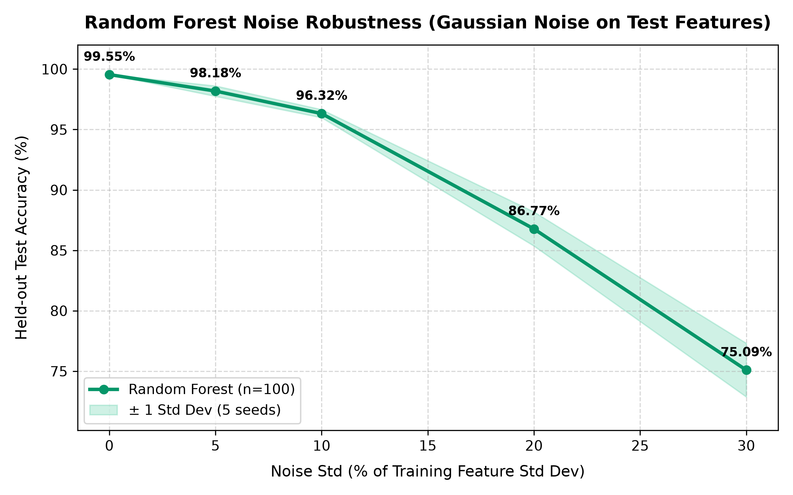

# Classifier Robustness & Evaluation Report

**Dataset:** `Crop_recommendation.csv` (2,200 samples, 22 crop classes, 7 numeric features)  
**Random State:** 42  
**Validation Strategy:** 5-Fold Stratified Cross-Validation with `StandardScaler` encapsulated in `sklearn.pipeline.Pipeline` (zero data leakage).  

---

## 1. 5-Fold Stratified Cross-Validation (Random Forest Classifier)

* **Model:** `RandomForestClassifier(n_estimators=100, random_state=42)`
* **Preprocessing:** `StandardScaler` inside Pipeline
* **Mean Accuracy:** **0.995455** (± 0.003214) [99.55%]
* **Mean Macro-F1:** **0.995448** (± 0.003217) [99.54%]

## 2. Model Baseline Comparison (5-Fold Stratified CV)

| Model | Preprocessing | Mean Accuracy | Std Dev | Mean Macro-F1 | Std Dev |
| :--- | :--- | :---: | :---: | :---: | :---: |
| **Random Forest (n=100)** | StandardScaler (Pipeline) | 0.995455 (99.55%) | ± 0.003214 | 0.995448 (99.54%) | ± 0.003217 |
| **Decision Tree** | StandardScaler (Pipeline) | 0.987727 (98.77%) | ± 0.006833 | 0.987724 (98.77%) | ± 0.006831 |
| **K-Nearest Neighbors (k=5)** | StandardScaler (Pipeline) | 0.971364 (97.14%) | ± 0.006833 | 0.971212 (97.12%) | ± 0.006828 |
| **Logistic Regression** | StandardScaler (Pipeline) | 0.970909 (97.09%) | ± 0.002227 | 0.970725 (97.07%) | ± 0.002270 |
| **XGBoost** | StandardScaler (Pipeline) | 0.993182 (99.32%) | ± 0.002490 | 0.993178 (99.32%) | ± 0.002491 |

---

## 3. Noise Robustness Analysis

The model was trained on clean training data (80% split, 1,760 samples). Gaussian noise with standard deviation proportional to each feature's training standard deviation (0%, 5%, 10%, 20%, 30%) was injected into the test features (440 samples) across 5 independent random seeds.

| Noise Level (% of Feature Std) | Mean Test Accuracy | Std Dev | Individual Seed Accuracies (5 Seeds) |
| :---: | :---: | :---: | :--- |
| **0%** | **0.995455** (99.55%) | ± 0.000000 | [0.9955, 0.9955, 0.9955, 0.9955, 0.9955] |
| **5%** | **0.981818** (98.18%) | ± 0.004312 | [0.9864, 0.9795, 0.9750, 0.9818, 0.9864] |
| **10%** | **0.963182** (96.32%) | ± 0.003340 | [0.9659, 0.9614, 0.9591, 0.9614, 0.9682] |
| **20%** | **0.867727** (86.77%) | ± 0.014113 | [0.8864, 0.8455, 0.8591, 0.8750, 0.8727] |
| **30%** | **0.750909** (75.09%) | ± 0.022203 | [0.7864, 0.7250, 0.7659, 0.7364, 0.7409] |

---

## 4. Feature Ablation Study (Drop-One-Feature-Out CV)

Evaluates the impact on 5-fold cross-validation accuracy when removing each feature individually:

| Dropped Feature | Features Retained | Mean CV Accuracy | Std Dev | Accuracy Delta vs Baseline |
| :--- | :---: | :---: | :---: | :---: |
| **None (All Features)** | 7/7 | 0.995455 (99.55%) | ± 0.003214 | Baseline |
| **N** | 6/7 | 0.994545 (99.45%) | ± 0.002318 | +0.000909 |
| **P** | 6/7 | 0.990909 (99.09%) | ± 0.003521 | +0.004545 |
| **K** | 6/7 | 0.991364 (99.14%) | ± 0.005262 | +0.004091 |
| **temperature** | 6/7 | 0.994545 (99.45%) | ± 0.003083 | +0.000909 |
| **humidity** | 6/7 | 0.983182 (98.32%) | ± 0.005102 | +0.012273 |
| **ph** | 6/7 | 0.991818 (99.18%) | ± 0.003402 | +0.003636 |
| **rainfall** | 6/7 | 0.966818 (96.68%) | ± 0.007273 | +0.028636 |

---

## 5. Random Forest Feature Importances (MDI)

| Rank | Feature | Description | Importance Score | Percentage |
| :---: | :--- | :--- | :---: | :---: |
| 1 | **`rainfall`** | Rainfall in mm | 0.225676 | 22.57% |
| 2 | **`humidity`** | Relative humidity (%) | 0.215976 | 21.60% |
| 3 | **`K`** | Potassium content in soil (mg/kg) | 0.177675 | 17.77% |
| 4 | **`P`** | Phosphorus content in soil (mg/kg) | 0.152107 | 15.21% |
| 5 | **`N`** | Nitrogen content in soil (mg/kg) | 0.101705 | 10.17% |
| 6 | **`temperature`** | Temperature (°C) | 0.073685 | 7.37% |
| 7 | **`ph`** | Soil pH level | 0.053175 | 5.32% |

